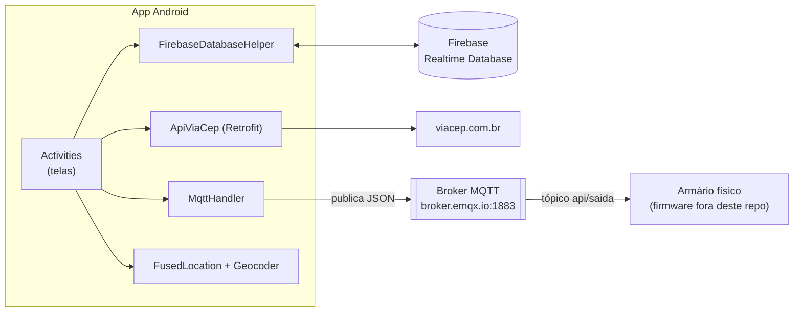
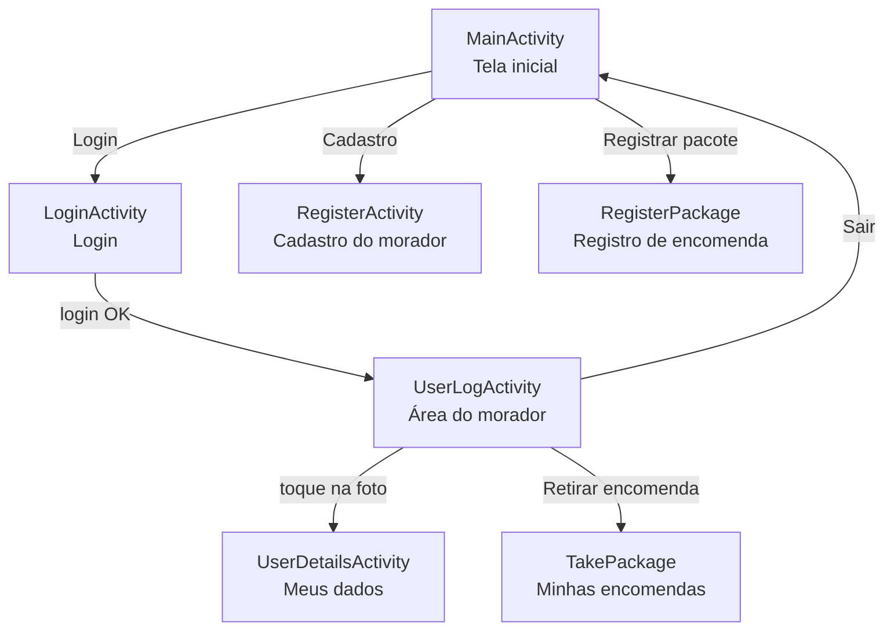
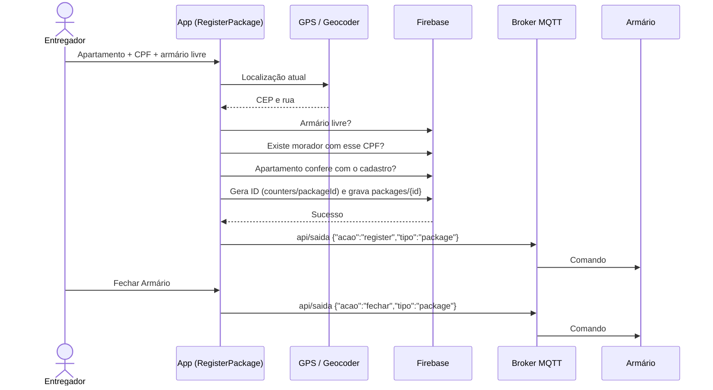
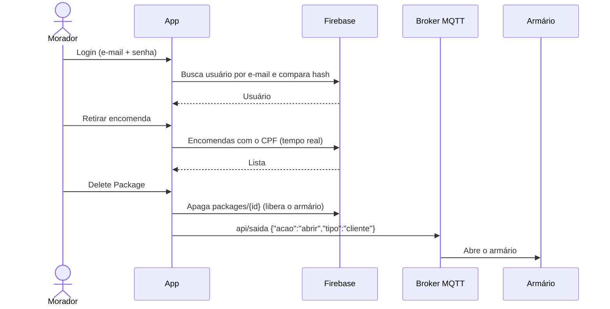

# ArmLocker — Armário Inteligente para Encomendas

Aplicativo Android, escrito em **Kotlin**, para um **armário inteligente (smart locker)** de condomínio.
O entregador registra a encomenda em um dos compartimentos do armário e o morador, depois de fazer login,
vê as encomendas que estão no seu nome e libera a retirada.

O app guarda os dados no **Firebase Realtime Database** e conversa com o hardware do armário por **MQTT**.

> Projeto desenvolvido com fins acadêmicos.

---

## Sumário

1. [Visão geral](#visão-geral)
2. [Funcionalidades](#funcionalidades)
3. [Tecnologias e versões](#tecnologias-e-versões)
4. [Arquitetura](#arquitetura)
5. [Estrutura de pastas](#estrutura-de-pastas)
6. [Telas e navegação](#telas-e-navegação)
7. [Código-fonte, arquivo por arquivo](#código-fonte-arquivo-por-arquivo)
8. [Modelo de dados no Firebase](#modelo-de-dados-no-firebase)
9. [Comunicação MQTT com o armário](#comunicação-mqtt-com-o-armário)
10. [Fluxos principais](#fluxos-principais)
11. [Permissões](#permissões)
12. [Como executar](#como-executar)
13. [Testes](#testes)
14. [Limitações conhecidas e pontos de atenção](#limitações-conhecidas-e-pontos-de-atenção)
15. [English summary](#english-summary)

---

## Visão geral

O sistema envolve três participantes:

| Participante | Papel |
|---|---|
| **Morador** | Faz o cadastro, entra com e-mail e senha, consulta os próprios dados, vê as encomendas no seu nome e confirma a retirada (o que manda o armário abrir). |
| **Entregador** | Na tela inicial, toca em "Registrar pacote", informa apartamento e CPF do morador, escolhe um armário livre e registra a encomenda. Também pode mandar o comando de "Fechar Armário". |
| **Armário físico** | Recebe comandos JSON por MQTT no tópico `api/saida`. O firmware do armário **não está neste repositório**: aqui está só o app. |

O CPF é o que liga uma encomenda ao morador: o entregador digita o CPF e o morador vê todas as encomendas registradas com o CPF dele.

---

## Funcionalidades

**Morador**
- Cadastro com nome, sobrenome, e-mail, senha, data de nascimento, CPF, CEP, estado, cidade, rua, complemento (apartamento) e telefone.
- Máscaras de digitação nos campos de CPF (`###.###.###-##`), data (`##/##/####`), CEP (`#####-###`) e telefone (`(##) #####-####`).
- Preenchimento automático do endereço de duas formas:
  - pela **localização do aparelho** (GPS + `Geocoder` do Android), ao abrir a tela;
  - pela **API ViaCEP**, quando o campo CEP perde o foco com 8 dígitos.
- Senha guardada como **hash SHA-256**, nunca em texto puro.
- Login com e-mail e senha.
- Tela inicial do morador com mensagem de boas-vindas, acesso aos dados cadastrais (tocando na foto), botão "Retirar encomenda" e botão "Sair".
- Lista das encomendas do morador, atualizada **em tempo real** pelo Firebase e com "puxar para atualizar".
- Retirada: apaga a encomenda do banco e envia ao armário o comando MQTT `abrir`.

**Entregador**
- Escolha do compartimento entre os **armários livres** (`Locker 1`, `Locker 2`, `Locker 3`). Um armário fica ocupado enquanto houver encomenda nele.
- Validações antes de gravar a encomenda:
  1. o armário escolhido não pode estar em uso;
  2. precisa existir um morador cadastrado com o CPF informado;
  3. o apartamento digitado precisa ser igual ao **complemento** do cadastro desse morador.
- Grava o CEP e a rua de onde a encomenda foi registrada (localização do aparelho do entregador).
- Envia ao armário o comando MQTT `register` quando a encomenda é registrada.
- Botão "Fechar Armário", que envia o comando MQTT `fechar` (usa o CPF que estiver digitado no campo).

---

## Tecnologias e versões

| Item | Versão / valor |
|---|---|
| Linguagem | Kotlin 1.9.24 |
| Android Gradle Plugin | 8.7.3 |
| Gradle (wrapper) | 8.9 |
| `compileSdk` / `targetSdk` / `minSdk` | 35 / 34 / 24 (Android 7.0+) |
| Bytecode Java | 11 |
| UI | XML Views + **View Binding** (`ConstraintLayout`, `LinearLayout`, `RecyclerView`, `SwipeRefreshLayout`), tema Material 3 |
| Banco de dados | Firebase Realtime Database (`firebase-database-ktx` 21.0.0, BoM 33.7.0), com cache offline ligado |
| Mensageria | Eclipse Paho MQTT v3 (`org.eclipse.paho.client.mqttv3` 1.2.0) |
| HTTP | Retrofit 2.9.0 + Gson (API ViaCEP) |
| Localização | Google Play Services Location 21.3.0 (`FusedLocationProviderClient`) + `android.location.Geocoder` |
| Imagens | Picasso 2.71828 |
| Outras dependências declaradas | Firebase Analytics, Firebase Auth e Firebase Storage (declaradas no Gradle, mas não usadas no código) |

As versões ficam em [`gradle/libs.versions.toml`](gradle/libs.versions.toml) e [`app/build.gradle.kts`](app/build.gradle.kts).

---

## Arquitetura

O app segue o modelo clássico de **Activities**: cada tela é uma `Activity` que cuida da sua interface e chama diretamente
os serviços de que precisa. Não há ViewModel nem camada de repositório. Todo o acesso ao banco está concentrado em uma
classe, `FirebaseDatabaseHelper`.



---

## Estrutura de pastas

```
finalArmLocker/
├── build.gradle.kts              # Build raiz: plugins Android, Kotlin e Google Services
├── settings.gradle.kts           # Nome do projeto (FinalArmLocker) e módulo :app
├── gradle.properties             # Configurações do Gradle (AndroidX, memória da JVM, etc.)
├── gradle/
│   ├── libs.versions.toml        # Catálogo de versões das dependências
│   └── wrapper/                  # Gradle Wrapper 8.9
├── gradlew / gradlew.bat         # Scripts para rodar o Gradle sem instalá-lo
└── app/
    ├── build.gradle.kts          # Configuração do módulo: SDKs, View Binding, dependências
    ├── google-services.json      # Configuração do projeto Firebase (armlocker-787e0)
    ├── proguard-rules.pro        # Regras do ProGuard (padrão, minify desligado)
    └── src/
        ├── main/
        │   ├── AndroidManifest.xml
        │   ├── java/com/example/finalarmlocker/
        │   │   ├── MainActivity.kt          # Tela inicial + conexão MQTT
        │   │   ├── LoginActivity.kt         # Login do morador
        │   │   ├── RegisterActivity.kt      # Cadastro do morador (GPS + ViaCEP)
        │   │   ├── UserLogActivity.kt       # Tela inicial do morador logado
        │   │   ├── UserDetailsActivity.kt   # Dados cadastrais do morador
        │   │   ├── TakePackage.kt           # Lista de encomendas do morador
        │   │   ├── PackageAdapter.kt        # Adapter do RecyclerView + retirada
        │   │   ├── RegisterPackage.kt       # Registro de encomenda (entregador)
        │   │   ├── FireDatabaseHelper.kt    # Acesso ao Firebase + modelos User/Package
        │   │   ├── MqttHandler.kt           # Envoltório do cliente MQTT Paho
        │   │   ├── ApiViaCep.kt             # Interface Retrofit da API ViaCEP
        │   │   ├── AddressResponse.kt       # Modelo da resposta do ViaCEP
        │   │   ├── HashUtil.kt              # Hash SHA-256 de senhas
        │   │   └── MaskedEditText.kt        # EditText com máscara de digitação
        │   └── res/
        │       ├── layout/                  # Um XML por tela + item_package.xml
        │       ├── values/                  # cores, strings, temas, ids, attrs (máscara)
        │       ├── values-night/            # tema escuro
        │       ├── drawable-nodpi/          # logoarmlocker.png (logo 500x500)
        │       ├── drawable/, mipmap-*/     # ícones do app
        │       └── xml/                     # regras de backup
        ├── test/                            # Teste unitário de exemplo (template)
        └── androidTest/                     # Teste instrumentado de exemplo (template)
```

---

## Telas e navegação



| Tela (Activity) | Layout | O que mostra / faz |
|---|---|---|
| `MainActivity` (tela de abertura) | `activity_main.xml` | Logo e nome "ArmLocker", botões **Login**, **Cadastro** e **Registrar pacote**. Ao abrir, liga o cache offline do Firebase e conecta ao broker MQTT. |
| `LoginActivity` | `activity_login.xml` | Campos de e-mail e senha. Se der certo, abre `UserLogActivity` levando ID, primeiro nome e CPF do morador. |
| `RegisterActivity` | `activity_register.xml` | Formulário de cadastro com máscaras e preenchimento automático do endereço. |
| `UserLogActivity` | `activity_user_log.xml` | "Welcome, *nome*!", foto (ícone padrão), botões **Retirar encomenda** e **Sair**, e o texto "Histórico de encomendas". |
| `UserDetailsActivity` | `activity_user_details.xml` | Mostra os dados do morador buscados no Firebase pelo ID. |
| `TakePackage` | `activity_take_package.xml` + `item_package.xml` | Lista das encomendas do CPF do morador; cada item mostra apartamento, CPF e o botão **Delete Package**, que faz a retirada. |
| `RegisterPackage` | `activity_register_package.xml` | Campos de apartamento e CPF, lista de armários livres e os botões **Registrar pacote** e **Fechar Armário**. |

Quase todas as telas usam fundo preto com botões brancos. A exceção é `TakePackage`, que usa o fundo do tema.

---

## Código-fonte, arquivo por arquivo

### `MainActivity.kt`
Tela de entrada do app (a única marcada como `LAUNCHER` no manifest).
- Liga o modo *edge-to-edge* e ajusta o espaçamento conforme as barras do sistema.
- Chama `FirebaseDatabase.getInstance().setPersistenceEnabled(true)`, o que ativa o cache local do Firebase para o app funcionar offline.
- Cria um `MqttHandler`, conecta em `tcp://broker.emqx.io:1883`, assina o tópico `api/saida` (as mensagens recebidas só vão para o log com `println`) e publica uma **mensagem de teste** em `api/entrada`.
- Os três botões abrem `LoginActivity`, `RegisterActivity` e `RegisterPackage`.
- Em `onDestroy`, desconecta do broker.

### `LoginActivity.kt`
- Lê e-mail e senha e chama `FirebaseDatabaseHelper.checkUser`, que procura o usuário pelo e-mail e compara o hash SHA-256 da senha digitada com o hash salvo.
- Se der certo, abre `UserLogActivity` com os extras `USER_ID`, `USER_FIRST_NAME` e `USER_CPF` e fecha a tela de login.

### `RegisterActivity.kt`
- Monta o Retrofit com a URL base `https://viacep.com.br/ws/`.
- **Endereço por CEP:** quando o campo CEP perde o foco, tira o hífen e, se sobrarem 8 dígitos, chama a ViaCEP e preenche rua, cidade e UF, mas só nos campos que estiverem vazios.
- **Endereço por GPS:** pede a permissão `ACCESS_FINE_LOCATION`. Com ela concedida, recebe atualizações de localização (a cada 5 s, alta precisão) e usa o `Geocoder` para converter latitude e longitude em CEP, rua, cidade e estado.
- Flags (`isCepSetAutomatically` e outras) evitam que o preenchimento automático sobrescreva o que o usuário digitou. Elas voltam a `false` quando o CEP é alterado.
- Ao tocar em **Cadastrar**: confere se todos os campos estão preenchidos, gera o hash da senha com `HashUtil`, monta um `FirebaseDatabaseHelper.User` e chama `insertUser`.

### `UserLogActivity.kt`
- Mostra a mensagem de boas-vindas usando a string `welcome_message` (`"Welcome, %1$s!"`).
- Tentaria carregar uma foto com Picasso a partir do extra `USER_PHOTO_URI`, mas nenhuma tela envia esse extra. Por isso aparece sempre o ícone padrão.
- Tocar na foto abre `UserDetailsActivity` com o `USER_ID`.
- **Retirar encomenda** abre `TakePackage` com o CPF e o nome.
- **Sair** volta para `MainActivity` com `FLAG_ACTIVITY_CLEAR_TOP | FLAG_ACTIVITY_NEW_TASK`.

### `UserDetailsActivity.kt`
Recebe o `USER_ID`, busca o usuário com `getUserByID` e preenche os `TextView`s com nome, sobrenome, telefone, e-mail, CPF, CEP, cidade, rua, apartamento, data de nascimento e estado.

### `TakePackage.kt`
- Recebe `USER_CPF` e `USER_FIRST_NAME`.
- Configura o `RecyclerView` com um `PackageAdapter` e o `SwipeRefreshLayout`.
- Busca as encomendas de duas formas:
  - `getPackagesByCPF`: leitura única, feita ao abrir a tela, no `onResume` e ao puxar para atualizar;
  - `addPackagesListener`: um *listener* que atualiza a lista em tempo real sempre que algo muda no Firebase.

### `PackageAdapter.kt`
Adapter do `RecyclerView` que desenha cada encomenda (`item_package.xml`). O botão **Delete Package** é a **retirada**:
1. apaga a encomenda do Firebase (`deletePackageById`), o que também libera o armário;
2. se deu certo, cria um `MqttHandler` novo, conecta, publica `{"cpf": "...", "acao": "abrir", "tipo": "cliente"}` em `api/saida` e desconecta;
3. tira o item da lista na tela.

### `RegisterPackage.kt`
Tela do entregador.
- Conecta ao broker MQTT ao abrir.
- Monta o *spinner* de armários: lê todas as encomendas (`getAllPackages`) e mostra só os itens da lista fixa `["Locker 1", "Locker 2", "Locker 3"]` que não estão em uso.
- **Registrar pacote:**
  1. confere se os campos estão preenchidos e desabilita o botão (contra clique duplo);
  2. pede a permissão de localização ou, se ela já existir, pega a localização atual;
  3. com o `Geocoder`, descobre CEP e rua do local e monta um `FirebaseDatabaseHelper.Package`;
  4. chama `insertPackage`, que faz as validações descritas em [Funcionalidades](#funcionalidades);
  5. se der certo, limpa os campos, publica `{"cpf": "...", "acao": "register", "tipo": "package"}` em `api/saida` e tira o armário da lista de livres.
- **Fechar Armário:** publica `{"cpf": "...", "acao": "fechar", "tipo": "package"}` em `api/saida` usando o CPF digitado.

### `FireDatabaseHelper.kt` (classe `FirebaseDatabaseHelper`)
Concentra todo o acesso ao Realtime Database. Repare que o arquivo declara `package com.example.projetoarmario` (nome de uma versão anterior do projeto), diferente da pasta onde está. Por isso as outras classes o importam como `com.example.projetoarmario.FirebaseDatabaseHelper`.

| Método | O que faz |
|---|---|
| `insertUser(user, callback)` | Gera um ID sequencial com uma **transação** em `counters/userId` e grava o usuário em `users/{id}`. |
| `insertPackage(pkg, callback)` | Confere se o armário está livre (`packages` por `locker`), se existe usuário com o CPF (`users` por `cpf`) e se `user.apartament == pkg.apartmentNumber`. Depois gera um ID com transação em `counters/packageId` e grava em `packages/{id}`. |
| `checkUniqueFields(email, cpf, callback)` | Confere se e-mail e CPF ainda não existem. Está implementado, mas **não é chamado** em nenhum lugar. |
| `getPackagesByCPF(cpf, callback)` | Leitura única das encomendas de um CPF. Devolve `null` se não houver nenhuma. |
| `addPackagesListener(cpf, callback)` | Mesma consulta, mas com *listener* permanente (tempo real). |
| `getAllPackages(callback)` | Lê todas as encomendas (usado para saber quais armários estão ocupados). |
| `deletePackageById(id, callback)` | Apaga `packages/{id}`. |
| `getPackagesRef()` | Devolve a referência `packages` (não é usado). |
| `checkUser(email, senha, callback)` | Login: procura pelo e-mail e compara o hash SHA-256 da senha. |
| `getUserByID(id, callback)` | Lê `users/{id}`. |

Também define as *data classes* `User` e `Package` (veja [Modelo de dados](#modelo-de-dados-no-firebase)).

### `MqttHandler.kt`
Envoltório simples do `MqttClient` síncrono do Paho, com persistência em memória e `cleanSession = true`. Tem os métodos `connect`, `disconnect`, `publish` (QoS padrão) e `subscribe`. As exceções só aparecem no log, com `printStackTrace`.

### `ApiViaCep.kt` e `AddressResponse.kt`
- `ApiViaCep`: interface Retrofit com `GET {cep}/json/`.
- `AddressResponse`: *data class* com os campos que a ViaCEP devolve (`cep`, `logradouro`, `complemento`, `bairro`, `localidade`, `uf`, `unidade`, `ibge`, `gia`).

### `HashUtil.kt`
`hashPassword(senha)` devolve o SHA-256 da senha em hexadecimal (64 caracteres).

### `MaskedEditText.kt`
`EditText` próprio que aplica uma máscara definida no XML pelo atributo `app:mask` (declarado em `res/values/attrs.xml`). Cada `#` da máscara recebe um dígito e os outros caracteres (`.`, `-`, `/`, `(`, `)`, espaço) são inseridos automaticamente. Tudo que não for dígito é descartado do que o usuário digita.

---

## Modelo de dados no Firebase

Projeto Firebase: `armlocker-787e0` (Realtime Database em `https://armlocker-787e0-default-rtdb.firebaseio.com`).

Exemplo da estrutura que o app grava:

```json
{
  "counters": {
    "userId": 1,
    "packageId": 1
  },
  "users": {
    "1": {
      "id": 1,
      "firstName": "Maria",
      "lastName": "Silva",
      "email": "maria@exemplo.com",
      "password": "<hash SHA-256 em hexadecimal>",
      "birthDate": "01/01/2000",
      "cpf": "123.456.789-00",
      "cep": "01001-000",
      "street": "Praça da Sé",
      "city": "São Paulo",
      "state": "SP",
      "phone": "(11) 91234-5678",
      "apartament": "101"
    }
  },
  "packages": {
    "1": {
      "id": 1,
      "apartmentNumber": "101",
      "cpf": "123.456.789-00",
      "cep": "01001-000",
      "street": "Praça da Sé",
      "locker": "Locker 1"
    }
  }
}
```

Detalhes importantes:
- **IDs sequenciais** (1, 2, 3...) gerados por transação nos nós `counters/userId` e `counters/packageId`.
- O **CPF é gravado com a máscara** (`000.000.000-00`). Como cadastro e registro de encomenda usam a mesma máscara, as buscas por CPF funcionam.
- O campo `apartament` (grafia do código) é o campo **"Complemento"** do cadastro. O entregador precisa digitar exatamente o mesmo valor em "Apartment Number".
- `cep` e `street` da encomenda vêm da **localização do entregador** no momento do registro, não do endereço do morador.
- O campo `locker` diz qual compartimento está ocupado. Quando a encomenda é apagada (retirada), o armário volta a ficar livre.
- As consultas usam `orderByChild` em `email`, `cpf` e `locker`. As regras do banco não estão no repositório. Para melhorar o desempenho, vale declarar os índices nas regras do Firebase:

  ```json
  {
    "rules": {
      "users":    { ".indexOn": ["email", "cpf"] },
      "packages": { ".indexOn": ["cpf", "locker"] }
    }
  }
  ```

---

## Comunicação MQTT com o armário

- **Broker:** `tcp://broker.emqx.io:1883` (broker público da EMQX, sem TLS).
- **Credenciais e client ID:** fixos no código, em `MainActivity`, `RegisterPackage` e `PackageAdapter`. O client ID é sempre `Armario`.
- **Formato das mensagens:** JSON com três campos: `cpf`, `acao` e `tipo`.

| Quando | Onde no código | Tópico | Mensagem |
|---|---|---|---|
| App abre (mensagem de teste, CPF fixo) | `MainActivity.kt:49` | `api/entrada` | `{"cpf": "12345678900", "acao": "open", "tipo": "package"}` |
| Encomenda registrada | `RegisterPackage.registerPackage` | `api/saida` | `{"cpf": "<cpf>", "acao": "register", "tipo": "package"}` |
| Entregador toca em "Fechar Armário" | `RegisterPackage` | `api/saida` | `{"cpf": "<cpf>", "acao": "fechar", "tipo": "package"}` |
| Morador retira a encomenda | `PackageAdapter.sendMqttMessage` | `api/saida` | `{"cpf": "<cpf>", "acao": "abrir", "tipo": "cliente"}` |

O app também **assina** `api/saida` na `MainActivity`, mas só escreve as mensagens no log.

> As mensagens **não dizem qual compartimento** (`Locker 1/2/3`) deve abrir ou fechar. Elas levam só o CPF.
> O firmware precisa descobrir o compartimento de outra forma, ou esse campo precisa ser incluído no futuro.

---

## Fluxos principais

### Cadastro do morador
1. Na tela inicial, o morador toca em **Cadastro**.
2. O app pede permissão de localização e tenta preencher CEP, rua, cidade e estado pelo GPS.
3. O morador preenche ou corrige os campos. Ao sair do campo CEP, a ViaCEP completa o endereço.
4. **Cadastrar** gera o hash da senha e grava o usuário em `users/{id}`.

### Registro de encomenda (entregador)



### Retirada (morador)



---

## Permissões

| Permissão | Para quê |
|---|---|
| `ACCESS_FINE_LOCATION` / `ACCESS_COARSE_LOCATION` | Preencher o endereço no cadastro e gravar o local de registro da encomenda. |
| `CAMERA` (opcional, `required="false"`) | Declarada no manifest, mas não é usada pelo código. |
| `INTERNET` | Não aparece no manifest do app. Ela é incluída automaticamente pelas bibliotecas do Firebase na junção dos manifests (*manifest merge*). |

---

## Como executar

### Pré-requisitos
- **Android Studio Ladybug (2024.2) ou mais recente**, compatível com o AGP 8.7.
- **JDK 17** para rodar o Gradle (o JDK que vem com o Android Studio já serve).
- Aparelho ou emulador com **Android 7.0 (API 24) ou superior** e **Google Play Services** (necessário para a localização).
- Conexão com a internet (Firebase, ViaCEP e broker MQTT).

### Passos
1. Clone o repositório e abra a pasta no Android Studio.
2. Espere o **Gradle Sync** terminar. O arquivo `local.properties`, com o caminho do Android SDK, é criado automaticamente.
3. O Firebase já está configurado por `app/google-services.json` (projeto `armlocker-787e0`). Para usar **o seu próprio** projeto Firebase:
   1. crie um projeto no [console do Firebase](https://console.firebase.google.com/);
   2. adicione um app Android com o pacote `com.example.finalarmlocker`;
   3. ative o **Realtime Database** e ajuste as regras de leitura e escrita;
   4. baixe o novo `google-services.json` e coloque-o em `app/`.
4. Rode o app pelo botão **Run** ou pela linha de comando:
   ```bash
   ./gradlew installDebug
   ```
5. No emulador, defina uma localização em *Extended Controls → Location*. Sem localização, o registro de encomenda não termina.

### Para testar o fluxo completo
1. Cadastre um morador e anote o CPF e o **Complemento** (apartamento).
2. Na tela inicial, toque em **Registrar pacote** e informe o mesmo apartamento e o mesmo CPF.
3. Volte, entre com o morador e toque em **Retirar encomenda**: a encomenda aparece na lista.
4. Para ver os comandos MQTT, assine `api/saida` em `broker.emqx.io:1883` com qualquer cliente MQTT (por exemplo, o MQTTX).

---

## Testes

Só existem os testes de exemplo gerados pelo template do Android Studio:
- `app/src/test/.../ExampleUnitTest.kt`, que confere `2 + 2 == 4`;
- `app/src/androidTest/.../ExampleInstrumentedTest.kt`, que confere o nome do pacote do app.

```bash
./gradlew test                  # testes unitários
./gradlew connectedAndroidTest  # testes instrumentados (precisa de aparelho/emulador)
```

---

## Limitações conhecidas e pontos de atenção

Pontos encontrados na leitura do código. Ficam registrados aqui para quem for continuar o projeto.

### Segurança
- **Não há autenticação de verdade.** O login lê o nó `users` e compara o hash da senha no próprio aparelho. O Firebase Auth está nas dependências, mas não é usado. Dependendo das regras do banco, qualquer pessoa com o app pode ler os dados e os hashes de todos os usuários.
- **SHA-256 sem *salt*** não é recomendado para senhas. Algoritmos próprios para isso são bcrypt, scrypt ou Argon2, ou então delegar a autenticação ao Firebase Auth.
- **O entregador não se identifica.** Qualquer pessoa pode abrir "Registrar pacote" na tela inicial.
- **MQTT sem proteção:** broker público, sem TLS (porta 1883) e com credenciais fixas no código. Qualquer cliente pode publicar em `api/saida`.

### Comportamentos e bugs
- **E-mail e CPF duplicados são aceitos.** `checkUniqueFields` (`FireDatabaseHelper.kt:127`) nunca é chamado, embora o erro do cadastro diga "Email ou CPF já existe!" (`RegisterActivity.kt:128`).
- **Risco de fechamento inesperado ao sair da conta.** `setPersistenceEnabled(true)` fica em `MainActivity.onCreate` (`MainActivity.kt:19`). O botão "Sair" recria a `MainActivity`, e o Firebase não aceita essa chamada depois que o banco já foi usado (lança `DatabaseException`). O lugar indicado para ela é uma classe `Application`.
- **O mesmo client ID MQTT (`Armario`) é usado em todas as conexões.** O broker derruba a conexão anterior quando outra entra com o mesmo ID. Por exemplo, a conexão temporária do `PackageAdapter` derruba a da `MainActivity`.
- **Chamadas MQTT na thread principal.** O `MqttClient` do Paho é síncrono, então conectar e publicar pode travar a interface.
- **Registrar pacote na primeira vez:** se a permissão de localização ainda não foi concedida, o app pede a permissão, mas depois não retoma o registro nem reativa o botão (`RegisterPackage.kt:176-185`). É preciso sair e voltar à tela.
- **Sem armários livres, o app fecha.** Com o *spinner* vazio, `selectedItem as String` (`RegisterPackage.kt:56`) falha.
- Em `UserLogActivity.kt:48`, o `intent.getIntExtra("USER_ID", -1)` lê o Intent novo, não o recebido, então o `USER_ID` repassado é sempre `-1`. Hoje isso não tem efeito, porque `TakePackage` não usa esse valor.
- A retirada ("Delete Package") não pede confirmação: um toque já apaga a encomenda e manda abrir o armário.
- O *listener* em tempo real de `TakePackage` nunca é removido e continua ativo depois que a tela fecha.

### Código e organização
- `FireDatabaseHelper.kt` declara o pacote `com.example.projetoarmario`, diferente da pasta `finalarmlocker`. Também há um segundo app (`com.example.projetoarmario`) no `google-services.json`. Os dois são resquícios de uma versão anterior.
- A lista de armários (`Locker 1..3`) e os dados do broker estão fixos no código.
- Há dependências sem uso: Firebase Auth, Firebase Storage, Firebase Analytics, Picasso (a foto nunca é enviada) e a permissão de câmera.
- O texto "Histórico de encomendas" aparece na tela, mas não tem funcionalidade.
- Os textos estão fixos nos layouts e misturam português e inglês. O ideal seria levá-los para `strings.xml`.
- Não há testes automatizados de verdade.

---

## English summary

**ArmLocker** is an Android app (Kotlin) for a smart parcel locker, built for academic purposes.

- **Residents** sign up (with input masks plus address autofill from GPS/Geocoder and the ViaCEP API), log in with e-mail and password (stored as a SHA-256 hash), see the packages linked to their CPF in real time, and withdraw them. Withdrawing deletes the package from the database and sends an `abrir` (open) command to the locker.
- **Delivery people** register a package by entering the resident's apartment and CPF and choosing a free locker (`Locker 1–3`). The app checks that the locker is free, the CPF exists and the apartment matches, saves the package with the current location, and sends a `register` command. They can also send a `fechar` (close) command.
- **Backend:** Firebase Realtime Database (`users`, `packages`, `counters`) with sequential IDs generated by transactions.
- **Hardware link:** MQTT (Eclipse Paho) through the public broker `broker.emqx.io:1883`, topic `api/saida`, JSON payload `{"cpf", "acao", "tipo"}`. The locker firmware is not part of this repository.
- **Stack:** AGP 8.7.3, Kotlin 1.9.24, compileSdk 35 / minSdk 24, View Binding, Retrofit, Play Services Location.
