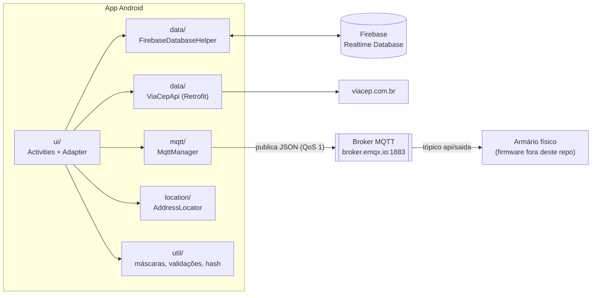
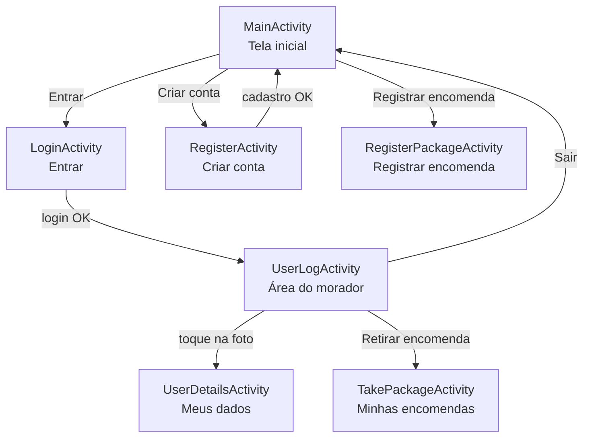
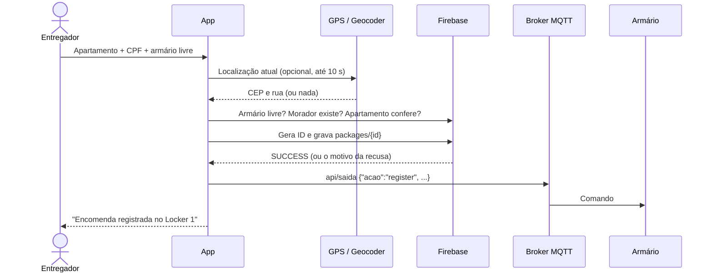
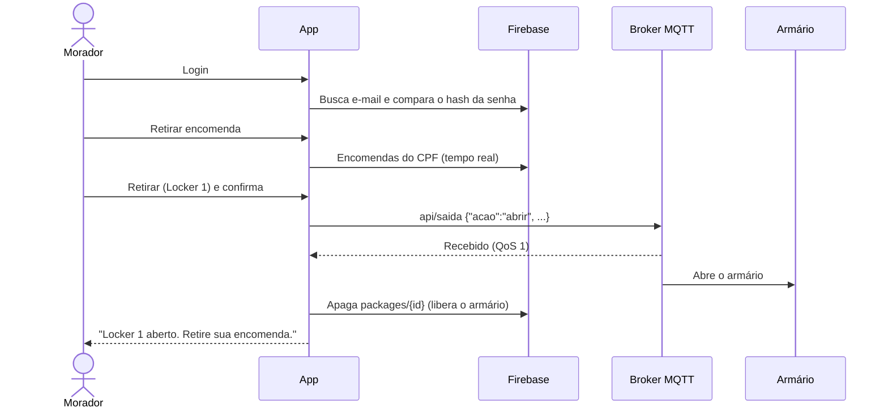

# ArmLocker: armário inteligente para encomendas

Aplicativo Android, escrito em **Kotlin**, para um **armário inteligente (smart locker)** de condomínio.
O entregador registra a encomenda em um dos compartimentos do armário e o morador, depois de fazer login,
vê as encomendas que estão no seu nome e libera a retirada.

O app guarda os dados no **Firebase Realtime Database** e conversa com o hardware do armário por **MQTT**.

> Projeto acadêmico, criado em 2023 e revisado na **versão 2.0**. As mudanças estão listadas em [O que mudou na versão 2.0](#o-que-mudou-na-versão-20).

> ⚠️ **O banco de dados do Firebase deste projeto (`armlocker-787e0`) está desativado.** Ao conectar, o servidor responde
> *"The Firebase database 'armlocker-787e0-default-rtdb' has been deactivated"*. Enquanto ele não for reativado no
> [console do Firebase](https://console.firebase.google.com/) (ou trocado por outro projeto, veja [Como executar](#como-executar)),
> login, cadastro e encomendas não funcionam. O app mostra uma mensagem de erro em vez de travar.

---

## Sumário

1. [Visão geral](#visão-geral)
2. [Funcionalidades](#funcionalidades)
3. [O que mudou na versão 2.0](#o-que-mudou-na-versão-20)
4. [Tecnologias e versões](#tecnologias-e-versões)
5. [Arquitetura](#arquitetura)
6. [Estrutura de pastas](#estrutura-de-pastas)
7. [Telas e navegação](#telas-e-navegação)
8. [Código-fonte, arquivo por arquivo](#código-fonte-arquivo-por-arquivo)
9. [Modelo de dados no Firebase](#modelo-de-dados-no-firebase)
10. [Comunicação MQTT com o armário](#comunicação-mqtt-com-o-armário)
11. [Fluxos principais](#fluxos-principais)
12. [Permissões](#permissões)
13. [Como executar](#como-executar)
14. [Testes](#testes)
15. [Limitações conhecidas e próximos passos](#limitações-conhecidas-e-próximos-passos)
16. [English summary](#english-summary)

---

## Visão geral

| Participante | Papel |
|---|---|
| **Morador** | Faz o cadastro, entra com e-mail e senha, consulta os próprios dados, vê as encomendas no seu nome e confirma a retirada, o que manda o armário abrir. |
| **Entregador** | Na tela inicial, toca em "Registrar encomenda", informa apartamento e CPF do morador, escolhe um armário livre e registra. Também pode mandar o armário fechar. |
| **Armário físico** | Recebe comandos JSON por MQTT no tópico `api/saida`. O firmware **não está neste repositório**: aqui está só o app. |

O **CPF** é o que liga uma encomenda ao morador: o entregador digita o CPF e o morador vê todas as encomendas registradas com ele.

---

## Funcionalidades

**Morador**
- Cadastro com validação de cada campo: CPF pelos dígitos verificadores, e-mail, senha com pelo menos 6 caracteres, data de nascimento que realmente exista, CEP e telefone.
- Máscaras aplicadas enquanto se digita: CPF `000.000.000-00`, data `dd/mm/aaaa`, CEP `00000-000` e telefone `(00) 00000-0000`.
- Endereço preenchido automaticamente, sempre só nos campos vazios:
  - pela **localização do aparelho** (uma única leitura de GPS + `Geocoder`);
  - pela **API ViaCEP**, assim que o CEP é digitado por completo.
- E-mail e CPF já cadastrados são recusados.
- Senha guardada como hash SHA-256, nunca em texto puro.
- Login por e-mail e senha.
- Área do morador com saudação, acesso aos dados cadastrais (tocando na foto), "Retirar encomenda" e "Sair".
- Lista de encomendas atualizada em **tempo real**, com "puxar para atualizar" e aviso quando não há nenhuma.
- Retirada com **confirmação**: o app manda o armário abrir e só depois tira a encomenda do sistema.

**Entregador**
- Escolhe entre os **armários livres** (`Locker 1`, `Locker 2`, `Locker 3`).
- Antes de gravar, o app confere: armário livre, morador existente com aquele CPF e apartamento igual ao do cadastro. Para cada problema aparece uma mensagem específica.
- Grava o CEP e a rua de onde a encomenda foi registrada. Se a localização não estiver disponível, registra mesmo assim.
- Avisa o armário (`register`) e informa se o aviso não chegou.
- "Fechar armário" usa o CPF digitado ou, se o campo estiver vazio, a última encomenda registrada na tela.

---

## O que mudou na versão 2.0

Mantido **compatível com a versão anterior**: a estrutura do banco e os nomes dos campos, o hash das senhas (as contas antigas continuam entrando), o tópico MQTT e o formato do JSON enviado ao armário.

### Defeitos corrigidos

| Problema na versão anterior | Correção |
|---|---|
| O app fechava ao tocar em "Sair": `setPersistenceEnabled` era chamado de novo quando a `MainActivity` era recriada. | Chamada movida para a classe `ArmLockerApp`, que roda uma única vez. |
| E-mail e CPF duplicados eram aceitos: `checkUniqueFields` existia, mas nunca era chamada. | O cadastro confere os dois e mostra o erro no campo certo. |
| O app fechava em "Registrar pacote" quando não havia armário livre. | Com todos ocupados, a tela avisa e desabilita o botão. |
| Depois de conceder a permissão de localização, o botão de registrar ficava travado. | O registro continua sozinho depois da resposta, com ou sem permissão. |
| No modo claro do sistema, o texto digitado em alguns campos ficava preto sobre o fundo preto. | Tema único e sempre escuro (Material 3). |
| Todas as conexões MQTT usavam o mesmo client ID, e uma derrubava a outra; as chamadas também travavam a tela. | Uma conexão única (`MqttManager`), com ID próprio, rodando fora da thread principal e com confirmação de entrega. |
| Retirada: a encomenda era apagada antes de mandar o armário abrir. Se o comando falhasse, ela sumia e o armário continuava fechado. | Primeiro abre o armário; só apaga se o comando chegou. Há uma confirmação antes. |
| O cadastro pedia localização a cada 5 segundos e nunca parava, gastando bateria. | Uma única leitura, com limite de tempo. |
| O `Geocoder` (que acessa a rede) rodava na thread principal. | Roda em segundo plano. |
| Sem resposta do servidor, as telas ficavam em "Aguarde…" para sempre. | Limite de 15 s em toda operação do banco, seguido de mensagem de erro. |
| O listener em tempo real das encomendas nunca era removido. | `Flow` ligado ao ciclo de vida da tela. |
| A máscara só formatava quando o campo estava completo. | Formata enquanto se digita, e o backspace funciona normalmente. |
| Ao abrir o app, era publicada uma mensagem de teste com um CPF fixo (`12345678900`). | Removida. |
| O ID do usuário se perdia ao abrir as encomendas (variável `intent` sombreada). | Corrigido. |
| Leituras podiam usar dados antigos do cache offline (risco de dois pacotes no mesmo armário). | Leituras com `get()`, que buscam no servidor quando há conexão. |
| "Falha ao registrar o pacote" valia para qualquer erro. | Mensagens específicas: CPF não encontrado, apartamento não confere, armário ocupado ou erro de conexão. |

### Outras melhorias
- **Visual:** layouts refeitos com Material 3 (campos com contorno, cards, botões), rolagem no cadastro e textos em português reunidos no `strings.xml`.
- **Organização:** código separado em pacotes (`data`, `mqtt`, `location`, `util`, `ui`), uso de coroutines no lugar de callbacks aninhados e configuração MQTT reunida em um só lugar.
- **Dependências:** todas no *version catalog*. Foram removidas as que não eram usadas (Picasso, Firebase Auth, Firebase Storage e a permissão de câmera) e o Paho MQTT foi atualizado para 1.2.5.
- **Testes:** 22 testes unitários (máscaras, validações, hash e formato dos comandos MQTT).
- **MQTT:** os comandos passam a informar o compartimento (`"locker"`). Dá para desligar isso em `MqttConfig.INCLUDE_LOCKER`.
- **E-mail:** salvo em minúsculas. O login aceita tanto as contas novas quanto as antigas.

---

## Tecnologias e versões

| Item | Versão / valor |
|---|---|
| Linguagem | Kotlin 1.9.24 + Coroutines 1.7.3 |
| Android Gradle Plugin / Gradle | 8.7.3 / 8.9 |
| `compileSdk` / `targetSdk` / `minSdk` | 35 / 34 / 24 (Android 7.0+) |
| Interface | XML Views + View Binding, Material Components 1.12 (tema Material 3 escuro), `RecyclerView`, `SwipeRefreshLayout` |
| Ciclo de vida | `lifecycle-runtime-ktx` 2.6.2 (`lifecycleScope`, `repeatOnLifecycle`) |
| Banco de dados | Firebase Realtime Database 21.0.0 (BoM 33.7.0), com cache offline |
| Mensageria | Eclipse Paho MQTT v3 1.2.5 |
| HTTP | Retrofit 2.9.0 + Gson (API ViaCEP) |
| Localização | Play Services Location 21.3.0 + `android.location.Geocoder` |

As versões ficam em [`gradle/libs.versions.toml`](gradle/libs.versions.toml).

---

## Arquitetura

Cada tela é uma `Activity` que usa serviços separados por responsabilidade. As operações demoradas (banco,
rede, MQTT, localização) são funções `suspend` chamadas dentro do `lifecycleScope` da tela, e são canceladas
sozinhas quando a tela fecha.



---

## Estrutura de pastas

```
finalArmLocker/
├── build.gradle.kts                 # Build raiz (plugins)
├── settings.gradle.kts              # Nome do projeto e módulo :app
├── gradle/libs.versions.toml        # Catálogo com todas as versões de dependências
└── app/
    ├── build.gradle.kts             # SDKs, View Binding e dependências
    ├── google-services.json         # Configuração do projeto Firebase
    └── src/
        ├── main/
        │   ├── AndroidManifest.xml
        │   ├── java/com/example/finalarmlocker/
        │   │   ├── ArmLockerApp.kt              # Application: liga o cache offline do Firebase
        │   │   ├── data/
        │   │   │   ├── FirebaseDatabaseHelper.kt  # Todo o acesso ao banco (suspend + Flow)
        │   │   │   ├── Models.kt                  # User, LockerPackage, lista de armários
        │   │   │   └── ViaCepApi.kt               # API ViaCEP (Retrofit) + AddressResponse
        │   │   ├── mqtt/
        │   │   │   ├── MqttConfig.kt              # Broker, tópico, credenciais, timeouts
        │   │   │   ├── LockerCommand.kt           # Comandos e formato JSON
        │   │   │   └── MqttManager.kt             # Conexão única, fora da thread principal
        │   │   ├── location/
        │   │   │   └── AddressLocator.kt          # Leitura única de GPS + Geocoder
        │   │   ├── util/
        │   │   │   ├── MaskFormatter.kt           # Máscaras (CPF, CEP, telefone, data)
        │   │   │   ├── InputValidators.kt         # Validações + CpfValidator
        │   │   │   ├── HashUtil.kt                # SHA-256 da senha
        │   │   │   └── UiExtensions.kt            # toast, validação de campos, etc.
        │   │   └── ui/
        │   │       ├── MainActivity.kt            # Tela inicial
        │   │       ├── LoginActivity.kt           # Login
        │   │       ├── RegisterActivity.kt        # Cadastro do morador
        │   │       ├── UserLogActivity.kt         # Área do morador
        │   │       ├── UserDetailsActivity.kt     # Meus dados
        │   │       ├── TakePackageActivity.kt     # Minhas encomendas / retirada
        │   │       ├── PackageAdapter.kt          # Itens da lista de encomendas
        │   │       ├── RegisterPackageActivity.kt # Registro de encomenda (entregador)
        │   │       ├── MaskedEditText.kt          # Campo com máscara
        │   │       └── IntentKeys.kt              # Nomes dos dados passados entre telas
        │   └── res/
        │       ├── layout/                        # Um XML por tela + item_package.xml
        │       ├── values/                        # strings (pt-BR), cores, tema e estilos, attrs
        │       ├── drawable/                      # ícone de pessoa, fundo do avatar
        │       └── drawable-nodpi/                # logoarmlocker.png
        ├── test/                                  # Testes unitários
        └── androidTest/                           # Teste instrumentado de exemplo
```

---

## Telas e navegação



| Tela | Layout | O que faz |
|---|---|---|
| `MainActivity` | `activity_main.xml` | Logo, nome e os botões **Entrar** e **Criar conta**. Embaixo, "É entregador? **Registrar encomenda**". |
| `LoginActivity` | `activity_login.xml` | E-mail e senha (com botão para mostrar a senha). Erros aparecem no próprio campo. |
| `RegisterActivity` | `activity_register.xml` | Formulário em duas seções (dados pessoais e endereço), com rolagem, máscaras, validação e endereço automático. |
| `UserLogActivity` | `activity_user_log.xml` | "Olá, *nome*!", avatar (abre "Meus dados"), **Retirar encomenda** e **Sair**. |
| `UserDetailsActivity` | `activity_user_details.xml` | Dados do morador, com indicador de carregamento e mensagem de erro. |
| `TakePackageActivity` | `activity_take_package.xml` + `item_package.xml` | Cards com armário e apartamento, botão **Retirar** e aviso de lista vazia. |
| `RegisterPackageActivity` | `activity_register_package.xml` | Apartamento, CPF, armários livres, **Registrar encomenda** e **Fechar armário**. |

---

## Código-fonte, arquivo por arquivo

### `ArmLockerApp.kt`
Classe `Application` registrada no manifest. Liga o cache offline do Firebase **uma única vez**, antes de qualquer uso do banco.

### `data/FirebaseDatabaseHelper.kt`
Todo o acesso ao Realtime Database. As funções são `suspend`, têm **limite de 15 s** e nunca lançam erro para a tela: em caso de falha, devolvem um resultado que a tela sabe tratar.

| Função | O que faz |
|---|---|
| `registerUser(user)` | Recusa e-mail ou CPF existentes, gera ID sequencial (transação em `counters/userId`) e grava em `users/{id}`. Devolve `SUCCESS`, `EMAIL_IN_USE`, `CPF_IN_USE` ou `ERROR`. |
| `login(email, senha)` | Busca pelo e-mail (como digitado e em minúsculas) e compara o hash da senha. Devolve `Success(user)`, `InvalidCredentials` ou `Error`. |
| `getUser(id)` | Lê `users/{id}`. |
| `registerPackage(pkg)` | Confere armário livre, morador com o CPF e apartamento igual ao do cadastro, gera ID (`counters/packageId`) e grava. Devolve `SUCCESS`, `LOCKER_IN_USE`, `USER_NOT_FOUND`, `APARTMENT_MISMATCH` ou `ERROR`. |
| `getOccupiedLockers()` | Armários em uso no momento. |
| `getPackagesByCpf(cpf)` | Leitura única das encomendas de um CPF. |
| `observePackagesByCpf(cpf)` | `Flow` com as encomendas em tempo real. O listener é removido quando a tela para de observar. |
| `deletePackage(id)` | Apaga a encomenda, o que libera o armário. |

### `data/Models.kt`
- `User` e `LockerPackage`: os campos têm exatamente os nomes gravados no banco, inclusive `apartament`, com essa grafia, por compatibilidade.
- `Lockers.ALL`: lista dos compartimentos físicos.

### `data/ViaCepApi.kt`
Interface Retrofit (`GET {cep}/json/`) com função `suspend`. O `AddressResponse` trata a resposta `{"erro": true}` que a ViaCEP devolve para CEP inexistente.

### `mqtt/MqttConfig.kt`, `mqtt/LockerCommand.kt` e `mqtt/MqttManager.kt`
- `MqttConfig`: broker, credenciais, tópico, QoS, timeouts e a opção `INCLUDE_LOCKER`.
- `LockerCommand`: os três comandos (`register`, `fechar`, `abrir`) e a montagem do JSON no mesmo formato da versão original.
- `MqttManager`: uma conexão para o app inteiro, aberta no primeiro envio e refeita se tiver caído. Roda em uma thread própria. `send(comando)` devolve `true` quando o broker confirma o recebimento.

### `location/AddressLocator.kt`
Faz uma leitura única de localização (limite de 10 s, com a última posição conhecida como alternativa) e usa o `Geocoder` em segundo plano. Devolve CEP, rua, cidade e estado, ou `null`.

### `util/`
- `MaskFormatter`: aplica as máscaras (`#` = dígito). Os separadores só entram quando há um dígito depois deles.
- `InputValidators` e `CpfValidator`: validações dos formulários.
- `HashUtil`: SHA-256 da senha, igual à versão original.
- `UiExtensions`: `toast`, `validateFields` (mostra os erros e põe o foco no primeiro campo inválido) e `clearErrorsOnEdit`.

### `ui/`
- **`MainActivity`**: navegação para as outras telas.
- **`LoginActivity`**: valida, chama `login` e abre a `UserLogActivity` com ID, nome e CPF.
- **`RegisterActivity`**: pede a localização ao abrir, consulta a ViaCEP ao completar o CEP, valida tudo, grava a conta e volta para a tela inicial.
- **`UserLogActivity`**: área do morador; o botão **Sair** volta para a tela inicial que já estava aberta.
- **`UserDetailsActivity`**: carrega e mostra os dados do morador.
- **`TakePackageActivity`** + **`PackageAdapter`**: lista em tempo real e retirada (confirmação → comando `abrir` → apagar a encomenda).
- **`RegisterPackageActivity`**: carrega os armários livres, registra a encomenda e envia `register` e `fechar`.
- **`MaskedEditText`**: `TextInputEditText` com o atributo `app:mask`.

---

## Modelo de dados no Firebase

Projeto: `armlocker-787e0` (`https://armlocker-787e0-default-rtdb.firebaseio.com`). Estrutura (igual à da versão anterior):

```json
{
  "counters": { "userId": 1, "packageId": 1 },
  "users": {
    "1": {
      "id": 1,
      "firstName": "Maria",
      "lastName": "Silva",
      "email": "maria@exemplo.com",
      "password": "<hash SHA-256 em hexadecimal>",
      "birthDate": "01/01/2000",
      "cpf": "529.982.247-25",
      "cep": "01001-000",
      "street": "Praça da Sé",
      "city": "São Paulo",
      "state": "SP",
      "phone": "(11) 91234-5678",
      "apartament": "101"
    }
  },
  "packages": {
    "1": {
      "id": 1,
      "apartmentNumber": "101",
      "cpf": "529.982.247-25",
      "cep": "01001-000",
      "street": "Praça da Sé",
      "locker": "Locker 1"
    }
  }
}
```

- IDs sequenciais gerados por **transação** nos nós `counters/*`.
- CPF e CEP são sempre gravados com a máscara (`000.000.000-00` e `00000-000`).
- `apartament` é o campo "Apartamento / complemento" do cadastro. O entregador precisa informar o mesmo valor (maiúsculas, minúsculas e espaços nas pontas são ignorados).
- `cep` e `street` da encomenda são de onde o entregador estava. Se a localização não estiver disponível, ficam vazios.
- As consultas filtram por `email`, `cpf` e `locker`. Vale declarar os índices nas regras do banco:

  ```json
  {
    "rules": {
      "users":    { ".indexOn": ["email", "cpf"] },
      "packages": { ".indexOn": ["cpf", "locker"] }
    }
  }
  ```

---

## Comunicação MQTT com o armário

- **Broker:** `tcp://broker.emqx.io:1883` (público, sem TLS). Configuração em [`MqttConfig.kt`](app/src/main/java/com/example/finalarmlocker/mqtt/MqttConfig.kt).
- **Tópico:** `api/saida`, com QoS 1.
- **Client ID:** `ArmLocker-` seguido de 8 caracteres aleatórios, diferente a cada execução do app.

| Quando | Mensagem |
|---|---|
| Encomenda registrada | `{"cpf": "<cpf>", "acao": "register", "tipo": "package", "locker": "Locker 1"}` |
| Entregador toca em "Fechar armário" | `{"cpf": "<cpf>", "acao": "fechar", "tipo": "package", "locker": "Locker 1"}` |
| Morador confirma a retirada | `{"cpf": "<cpf>", "acao": "abrir", "tipo": "cliente", "locker": "Locker 1"}` |

Os três primeiros campos, com a mesma ordem e os mesmos espaços, são idênticos aos da versão original. O campo
`locker` é novo e vem por último. Se o firmware não aceitar campos extras, basta mudar
`MqttConfig.INCLUDE_LOCKER` para `false`. No "Fechar armário", o `locker` só é enviado quando o app sabe qual é.

---

## Fluxos principais

### Registro de encomenda (entregador)



### Retirada (morador)



---

## Permissões

| Permissão | Para quê |
|---|---|
| `INTERNET` | Firebase, ViaCEP e broker MQTT. |
| `ACCESS_FINE_LOCATION` / `ACCESS_COARSE_LOCATION` | Preencher o endereço no cadastro e gravar onde a encomenda foi registrada. As duas são pedidas juntas; o usuário pode conceder só a aproximada. **Negar não impede** nenhum fluxo. |

---

## Como executar

### Pré-requisitos
- **Android Studio Ladybug (2024.2) ou mais recente.**
- **JDK 17 ou 21 para o Gradle.** O Gradle 8.9 **não roda com o JDK 25** que vem nas versões mais novas do Android Studio. Na IDE, ajuste em *Settings → Build, Execution, Deployment → Build Tools → Gradle → Gradle JDK*. Na linha de comando, aponte o `JAVA_HOME` para um JDK 17 ou 21.
- Aparelho ou emulador com Android 7.0+ e Google Play Services.

### Passos
1. Abra a pasta no Android Studio e espere o *Gradle Sync*.
2. **Firebase:** o `app/google-services.json` aponta para o projeto `armlocker-787e0`, cujo banco está **desativado**. Há duas saídas:
   - **reativar** o Realtime Database desse projeto no console do Firebase; ou
   - **criar um projeto novo:** adicione um app Android com o pacote `com.example.finalarmlocker`, ative o Realtime Database, configure as regras (incluindo os índices acima) e troque o `app/google-services.json`.
3. Rode pelo botão **Run** ou com `./gradlew installDebug`.

### Testando o fluxo completo
1. Crie uma conta e anote o CPF e o **apartamento / complemento**.
2. Na tela inicial, toque em **Registrar encomenda** e informe o mesmo apartamento e o mesmo CPF.
3. Entre com a conta e toque em **Retirar encomenda**: a encomenda aparece na lista.
4. Para ver os comandos enviados ao armário, assine `api/saida` em `broker.emqx.io:1883` com qualquer cliente MQTT (por exemplo, o MQTTX).

---

## Testes

```bash
./gradlew testDebugUnitTest      # 22 testes unitários (não precisam de aparelho)
./gradlew connectedAndroidTest   # teste instrumentado de exemplo (precisa de aparelho/emulador)
```

| Arquivo | O que cobre |
|---|---|
| `util/MaskFormatterTest` | Máscaras durante a digitação, backspace, texto já formatado e excesso de dígitos. |
| `util/ValidatorsTest` | CPF (válido, dígito errado, todos iguais), e-mail, senha, datas inexistentes e futuras, CEP e telefone. |
| `util/HashUtilTest` | Garante que o hash continua igual ao da versão original. |
| `mqtt/LockerCommandTest` | Garante o mesmo JSON da versão original e o campo `locker`. |

---

## Limitações conhecidas e próximos passos

**Segurança**: o ponto mais importante a evoluir.
- **Não há autenticação real.** O login compara o hash da senha no próprio aparelho, então as regras do banco precisam permitir a leitura de `users`. O caminho recomendado é o **Firebase Authentication**, com regras de acesso por usuário. Isso exige ativar o provedor de e-mail/senha no console e migrar as contas existentes.
- **SHA-256 sem *salt*** não é adequado para senhas. Com o Firebase Auth, o app deixa de guardar senhas.
- **O entregador não se identifica.** Qualquer pessoa com o app pode registrar encomendas.
- **MQTT:** broker público, sem TLS e com credenciais no código. Qualquer cliente pode publicar em `api/saida`. Para uso real, é preciso um broker próprio com TLS e autenticação.

**Outras limitações**
- A checagem de "armário livre" e a gravação são duas etapas. Se dois entregadores registrarem no mesmo armário no mesmo instante, ambos podem conseguir.
- A sessão não é lembrada: ao fechar o app, é preciso entrar de novo.
- Se a conexão cair no meio de um cadastro, o app mostra erro depois de 15 s, mas o Firebase pode concluir a gravação quando a conexão voltar (por causa do cache offline).
- A lista de armários está fixa no código (`Lockers.ALL`).
- Para publicar na Play Store, falta trocar o `applicationId` (`com.example.*` não é aceito) e subir o `targetSdk` para 35.

---

## English summary

**ArmLocker** is an Android app (Kotlin) for a smart parcel locker. It started as an academic project in 2023 and was revised in v2.0.

- **Residents** sign up with field validation, input masks and address autofill (one-shot GPS + Geocoder, and the ViaCEP API). They log in with e-mail and password (stored as SHA-256), see their packages in real time, and withdraw them after a confirmation. The app sends `abrir` (open) to the locker and removes the package only if the broker acknowledged the command.
- **Delivery people** pick a free locker and register a package. The app checks that the locker is free, the CPF exists and the apartment matches, then sends `register`. They can also send `fechar` (close).
- **Backend:** Firebase Realtime Database (`users`, `packages`, `counters`). ⚠️ The current Firebase database instance is deactivated and must be re-enabled or replaced.
- **Hardware link:** a single shared MQTT connection (Eclipse Paho) on a background thread, to `broker.emqx.io:1883`, topic `api/saida`. The JSON payload is backward compatible and adds an optional `locker` field.
- **v2.0 fixes:** a crash on logout, a crash with no free lockers, duplicate accounts, invisible text in light mode, MQTT client ID collisions and UI freezes, a withdrawal that could lose packages, endless location updates, endless loading without a server, and leaked listeners. It also adds a Material 3 redesign, a package structure, coroutines and 22 unit tests.
